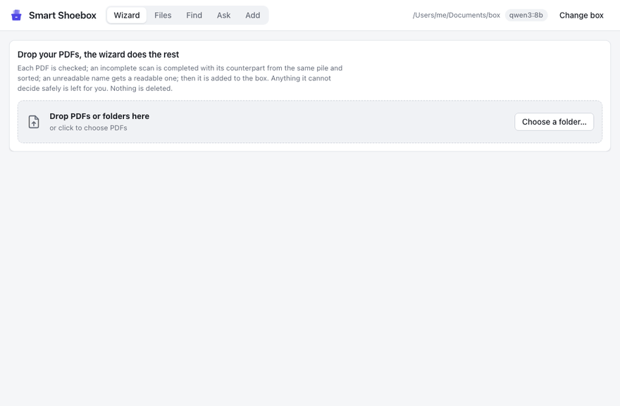
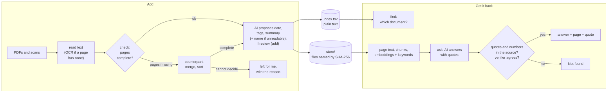

# Smart Shoebox

-blue>)

_The shoebox for your paperwork, except you can actually find things in it._

Smart Shoebox files private PDFs (tax notices, contracts, invoices) into a local
archive. A local AI model completes split scans, gives each file a readable
name, a date, tags and a summary, and answers questions about the content with
checked quotes. No document leaves the machine.

_Demo with sample data. The documents and the answers are invented._

> **Learning project, under development.** I build it to learn AI agents and
> local models with Ollama. Interfaces, the index format and the prompts can
> still change, so keep a backup before batch commands like `wizard` or
> `name -y`. Built together with an AI coding assistant (Claude Code).

### How it works

- **Plain text over a database.** The index is greppable, diffable and survives
  any tool.
- **Hash-named store.** Content-addressed, so duplicates are skipped for free.
- **AI writes, I review.** `add` shows every proposal before it is saved. The
  `wizard` skips the review to handle a whole pile, so I look over its "added"
  list at the end.
- **Local models only.** Every AI step runs in Ollama on my machine.

## Quick start

All ways need [Ollama](https://ollama.com). OCR for scans is built in.
Building from source also needs CMake and a C++ compiler (macOS:
`brew install cmake`, plus the Xcode command line tools).

### 1. Desktop app (recommended, macOS)

1. Install: Rust 1.92+ and Node.js, then `cd gui && npm install`.
2. Select the models: `ollama pull qwen3:8b` and `ollama pull bge-m3` (the
   defaults in [`shoebox.example.yaml`](shoebox.example.yaml)).
3. Run: `npm run tauri dev`, or build the app with
   `npm run tauri build -- --bundles app`.
4. Prepare the box: on the first start, the app asks for a folder and creates
   the box there.
5. Drop PDFs or a folder of scans on the **Wizard** tab and click **Start**.

**Done:** the documents are in the box. Use **Find** and **Ask** to get them
back.

### 2. Command line

1. Install: `cargo install --path .` (puts `shoebox` on the PATH).
2. Select the models: `ollama pull qwen3:8b` and `ollama pull bge-m3`.
3. Prepare the box: `shoebox init` creates `box/` with `shoebox.yaml`, `store/`
   and `index.tsv`. Change the model in `box/shoebox.yaml` if you like.
4. Run: `cd box`, then `shoebox wizard ~/Downloads/Scans` or
   `shoebox add ~/Downloads/bescheid.pdf`.

**Done:** `shoebox find "Wo ist mein Mietvertrag?"` shows the path to the PDF.

### 3. Demo with invented documents

1. Start Ollama (`ollama serve`) and pull the two models from step 2.
2. Run `demo/run.sh`. It makes fake paperwork, creates a fresh box, runs the
   wizard on it, then one `find` and one `ask`.

**Done:** the box is in `target/demo/box/`, its index is
`target/demo/box/index.tsv`.

## Options

| Command                   | What it does                                                                                                                       |
| ------------------------- | ---------------------------------------------------------------------------------------------------------------------------------- |
| `init [folder]`           | Create a box (settings, `store/`, empty index).                                                                                    |
| `add <file>…`             | Copy a PDF into the store, let the AI propose the entry, review it, add it to the index.                                           |
| `wizard <pdf or folder>…` | Handle a whole pile: check, complete, name and add, with a list of what needs a decision.                                          |
| `find "<question>"`       | Ask the AI which index rows match; `--to <folder>` copies them out with readable names.                                            |
| `ask "<question>"`        | Answer from the text inside the documents, with the source pages and a quote that the code checks. "Not found" instead of a guess. |
| `name <file>…`            | Rename PDFs to readable names like `2026-03-14_steuerbescheid-2025-finanzamt.pdf`.                                                 |
| `merge <a.pdf> <b.pdf>…`  | Append PDFs into one. No AI.                                                                                                       |
| `sort <scan.pdf>`         | Put the pages of a scan into reading order, using printed page numbers and AI grouping.                                            |
| `check <scan.pdf>`        | Is the scan complete, readable, and already in the box? Offers the fixes.                                                          |
| `counterpart <scan.pdf>`  | Find the other PDF that holds the missing pages, merge and sort both.                                                              |
| `text [--all]`            | Save the page text of documents added before it was kept.                                                                          |
| `chunks [--show <doc>]`   | Show how the documents are cut into chunks for searching inside them. No AI.                                                       |
| `embed`                   | Turn the chunks into vectors with the embedding model (only new or changed ones).                                                  |
| `search "<question>"`     | The best matching pages by meaning and by words, with scores. No answer.                                                           |

`shoebox --help` and `shoebox <command> --help` list all options. `-y` answers
yes to every prompt, so wrong AI proposals go through unchecked. Set
`SHOEBOX_DIR` to use a box that is not in the current folder or above it.

## Limitations

- **Status:** `init`, `add`, `find` and `name` are tested with my own documents.
  `merge`, `sort`, `check` and `counterpart` work; their rules are still being
  tuned. The `wizard` and the desktop app are new and the least tested.
- **Small local models make mistakes.** Proposals can have a wrong date or tag;
  that is why I review them. `ask` checks every quote and number against the
  source, but it cannot catch every wrong conclusion.
- **Speed:** OCR and the model run on the laptop, so a large pile of scans takes
  a while.
- **macOS first.** The desktop app is tested on macOS only. CI builds and
  tests it on Linux and Windows too.
- **No text layer.** OCR text is stored next to the PDF, not inside it, so text
  in a scanned PDF cannot be selected in a PDF viewer.
- **Not a document management system.** No web interface, no sync, no multiple
  users. For that, see
  [paperless-ngx](https://github.com/paperless-ngx/paperless-ngx).

## Privacy and backup

- Only the code is in Git. The box (`store/`, `index.tsv`, `shoebox.yaml`) and
  all PDFs are in `.gitignore`, in any folder. Never add them to a repository.
- The box is the **only copy** of the documents. Git does not back it up; use an
  external drive or similar.

## Built with

| Part        | Library                                                                                                                    | Purpose                                    |
| ----------- | -------------------------------------------------------------------------------------------------------------------------- | ------------------------------------------ |
| CLI         | [clap](https://crates.io/crates/clap)                                                                                      | commands and options                       |
| AI          | [ollama-rs](https://crates.io/crates/ollama-rs), [schemars](https://crates.io/crates/schemars)                             | local model calls with JSON-schema replies |
| PDF         | [lopdf](https://crates.io/crates/lopdf), [pdf-extract](https://crates.io/crates/pdf-extract)                               | read, merge, reorder pages; page text      |
| OCR         | [hayro](https://crates.io/crates/hayro), [kreuzberg-tesseract](https://crates.io/crates/kreuzberg-tesseract) (Tesseract 5) | render scanned pages, read their text      |
| Store       | [sha2](https://crates.io/crates/sha2)                                                                                      | content hash as the file name              |
| Desktop app | [Tauri 2](https://tauri.app), [Svelte 5](https://svelte.dev), TypeScript, Vite                                             | window and UI                              |

Written by hand: the scan checks (printed page numbers, counterpart matching,
page order), the chunking, the BM25 keyword search and the hybrid ranking, and
the quote check of `ask`.

## Documentation

- [docs/DETAILS.md](docs/DETAILS.md): full reference (index format, workflows
  for adding, finding, sorting and completing scans, the wizard, the desktop
  app, decisions and open questions)
- [testdata/README.md](testdata/README.md): the fake documents and the questions
  to measure search and answers
- [ROADMAP.md](ROADMAP.md): what comes next

## License

[MIT](LICENSE) © 2026 Volker Kuntner
